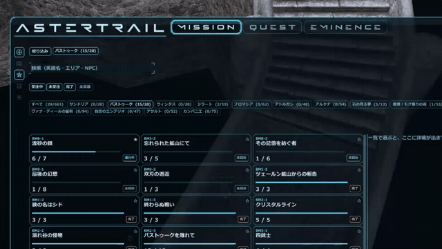

# japanese_ime

ファイナルファンタジーXI（Ashita v4 互換の環境。VanaCore で確かめています）で、
アドオンが自分の ImGui の入力欄に **日本語入力（IME）** の文字を受け取れるようにするプラグインです。
ゲームのチャット欄は閉じたままです。

- 作者: Tsukasa
- ライセンス: GPL-3.0（`LICENSE`）
- バージョン: 1.0
- ダウンロード: [Releases](https://github.com/Tsukasa-17/japanese_ime/releases)

> **このプラグインだけでは何もしません。** 対応しているアドオンの入力欄で日本語を打てるようにするための部品です。
> 対応しているアドオンと一緒に使ってください（ゲームのチャット欄の日本語入力は、このプラグインが無くてもいつもどおり使えます）。

## 日本語入力のようす（動画）

Astertrail の本の検索欄に、チャット欄を閉じたまま日本語（「クリスタル」）を打っているところです。

[](docs/demo.mp4)

[日本語入力のようす（動画・15 秒）](docs/demo.mp4)

## 対応しているアドオン

| アドオン | 作者 | リンク |
|---|---|---|
| Astertrail（アスタートレイル） | Tsukasa | https://github.com/Tsukasa-17/astertrail |

アドオンを対応させたら、Issue か Pull Request でアドオン名・作者・リンクを知らせてください。この表に足します
（対応のしかたは下の「アドオンから使う」と `samples/japanese_ime_client.lua`）。

## できること

- アドオンの入力欄が選ばれている間、IME で確定した文字と変換中の文字をアドオンに渡します。
- その間、ゲームのチャット欄が開かないようにします。
  - IME のキーや知らせ（`VK_PROCESSKEY`、`WM_IME_*`）をゲーム自身の処理に渡しません（ゲームの受け取り口のつなぎ替え。下の「しくみ」）。
  - Space・Enter・テンキーの Enter・Esc・Backspace・Tab・矢印・Delete・Home・End を、ゲームが読む DirectInput から隠します。日本語でも英数字でも同じです。押したキーは離すまで隠し、欄を抜けた直後（0.5 秒）も隠します。入力欄には Windows のキーの知らせで届くので、ふつうに使えます。
- IME が勝手に「A」（英数）に切り替わったり閉じたりしないよう、その間だけゲームの IME の操作を止めます。
- ゲームのチャット欄が開いている間は、取得を止めます（チャットの日本語入力はいつもどおり）。閉じたら戻ります。
- いくつかのアドオンが同時に使っても、文字は **最後に on にしたアドオン 1 つだけ** に届きます。

## 入れ方

1. `japanese_ime.dll` を `Vanacore\plugins\ashita\`（Ashita なら `plugins\`）に置きます。
2. ゲームの中で `/plugin load japanese_ime` と打ちます。
3. 外すときは `/plugin unload japanese_ime` です。外すと、つなぎ替えたところはすべて元に戻ります。

## コマンド

- `/jime status` … 今の状態（文字を受け取っているアドオン、チャット欄、隠したキーの数など）
- `/jime on` ／ `/jime off` … 試し用。アドオン無しで取得し、確定した文字をチャットに出します
- `/jime verbose` … 変換中の文字もチャットに出すかを切りかえます
- `/jime diag` … 診断の行をチャットにも出すかを切りかえます（記録にはいつも出ます）
- `/jime addon on <ID>` ／ `/jime addon off <ID>` … アドオン用の黙った切りかえ（知らせが届かない環境のため）

## アドオンから使う

アドオンがするのは、「入力欄を使い始めた／使い終わった」とプラグインに知らせることと、届いた文字を欄に入れることだけです。
チャット欄を閉じたままにすることと、IME が「A」（英数）に切り替わらないようにすることは、プラグインがします。

そのための部品（見本）が `samples/japanese_ime_client.lua` です。下の決まりを全部まとめてあるので、そのまま使えます。見本のバージョンは 1.1 です（プラグイン本体のバージョン 1.0 とは別です）。

### 置き方

`samples/japanese_ime_client.lua` を、**アドオンのフォルダ**（`アドオン名.lua` と同じ場所）に `japanese_ime_client.lua` という名前で置き、`require` で読みます。

VanaCore のアドオン:

```
Vanacore\addons\vanacore\youraddon\
  youraddon.lua
  japanese_ime_client.lua   ← ここに置く
```

Ashita のアドオン（VanaCore では `addons\ashita\<アドオン名>\`）:

```
Vanacore\addons\ashita\youraddon\
  youraddon.lua
  japanese_ime_client.lua   ← ここに置く
```

### 書き足すところ

```lua
local jime = require('japanese_ime_client')
jime.setup('youraddon')                  -- 読み込み時に 1 回。ID は英小文字の短い名前

-- 入力欄を描くとき（buf は { 文字 } の表）
imgui.InputText(jime.label('##search'), buf, 256)
if jime.field(imgui, buf, 256, '##search') then
    -- 日本語が入って buf[1] が変わった（検索し直すなど）
end

-- 毎フレームの最後に 1 回
jime.frame_end()

-- アンロード時
jime.shutdown()
```

- `jime.field(imgui)` だけでも動きます（`buf` などを渡さないときは、下の「文字の入れ方」の 2 つ目が使えません）。
- 欄が選ばれている間だけ `on`、外れたら `off` を送ります（選ばれた／外れた瞬間に 1 回ずつ）。ゲームのチャット欄が開いている間は、プラグインが自分で取得を止めるので、アドオンは何もしなくてかまいません。
- お知らせを出したくないときは `jime.setup('youraddon', { notify = false })`。
- 変換中かどうかは `jime.composing()` で調べられます（true / false）。確かめ用に `jime.state()` もあります。

### プラグインの見つけ方と送り方

- **読み込まれているか**：VanaCore の `vana.plugins.loaded()` を先に見ます。返ってくる名前は、小文字にして `_` と空白を除いてから `japaneseime` と比べます（`japanese_ime`・`Japanese_IME`・`japanese ime` などはどれも同じとみなします）。`vana.plugins` が無い環境では、Ashita の `AshitaCore:GetPluginManager():IsLoaded('japanese_ime')` を使います。VanaCore では、読み込み済みでも `IsLoaded('japanese_ime')` が false を返すことがあるので、`vana.plugins.loaded()` を先に見てください。
- **送る**：`vana.plugins.raise(名前, 中身)` を先に使い、無ければ `AshitaCore:GetPluginManager():RaiseEvent(名前, 中身, 長さ)` を使います。
- **受け取る**：`ashita.events.register('plugin_event', …)` で受けます。中身は `e.data`（文字）か、`e.data_raw` と `e.size`（`ffi.string` で読む）です。

### 返事と、返事が来ないときのコマンド

`on <ID>` を送ると、プラグインは `japanese_ime_state` で `on <いま文字を受け取っている ID>` を返します。自分の ID が返ってくれば届いています。

**1 秒たっても `on <自分の ID>` が返ってこなければ**、チャットに何も出ないコマンド `/jime addon on <ID>` でも頼みます（やめるときは `/jime addon off <ID>`）。たとえば次のようなときです。

- `vana.plugins.raise` も `RaiseEvent` も無い、または呼んでもプラグインまで届かない環境（Ashita 互換の層によっては、アドオンからの plugin_event がプラグインに渡らないことがあります）。
- プラグインを入れ直した直後などで、知らせを取りこぼしたとき。

コマンドは `vana.chat.run` を先に、無ければ `AshitaCore:GetChatManager():QueueCommand(-1, …)` で打ちます。

ほかのアドオンが後から `on` にしたときも `on <そのアドオンの ID>` が返ります。これは自分あてではないので、返事が来たことにはしません。

### 文字の入れ方

1. ImGui の `io:AddInputCharactersUTF8` があれば、それで入れます（カーソルの位置に入ります）。
2. 無ければ、`buf[1]` の後ろに足します。ImGui は描いている間の文字を自分で持っているので、そのままだと次のフレームで元の文字に戻されます。そこで、足した次の 1 フレームだけ `jime.label('##search')` が別の ID（`##search_jime`）を返し、ImGui に文字を読み直させます。ImGui は ID が変わると欄の選択が外れることがあるので、確定のたびに欄をクリックし直す必要があるかもしれません。VanaCore（ImGui 1.92.3）では 1 の経路が使われるため、この予備は通りません。

変換中の文字（`japanese_ime_comp`）は、見本では**欄の中**、打ってある文字のすぐ後ろに下線付きで出します（`jime.draw_comp`）。打ってある文字の幅（`CalcTextSize`）と欄の内側の余白（`FramePadding`）から位置を決め、欄の右端からはみ出すときは右端にそろえ、欄の外には描きません。要らなければ消してかまいません。変換中の文字は `GetForegroundDrawList` に描くため、他のウィンドウより手前に出ます。

- ImGui からはカーソルの位置が読めないので、**カーソルを文の途中に置いていても、変換中の文字は文の後ろ（右端寄り）に出ます**。確定した文字はカーソルの位置に入ります（`AddInputCharactersUTF8` を使えるとき）。
- 位置に打ってある文字を使うので、`jime.field(imgui)` だけ（`buf` を渡さない）のときは欄の左端に出ます。

### 状態のお知らせ（1 回だけ）

欄を選んだとき、うまく動いていなければチャットに 1 回だけ出します。VanaCore では `vana.encoding.to_shift_jis` で Shift-JIS に直してから出すので、日本語クライアントでも文字化けしません。

- 「japanese_ime プラグインが読み込まれていません」… プラグインが見つからない（`/plugin load japanese_ime` を打つ）。英数字はそのまま打てます。
- 「japanese_ime は読み込まれていますが、知らせに返事がありません。コマンドで頼みました」… 見つかったが、知らせが届いていない。コマンドで代わりに頼んでいます。

### 動いているかの確かめ方

- **`/jime status`**：アドオンの入力欄を選んでいる間に `/jime status` を打つと、1 行目の `owner=` に自分のアドオンの ID が出ます（例：`owner=youraddon`）。出ていれば届いています。`owner=-` なら、どのアドオンからも頼まれていません。
  チャット欄を開くために欄から離れると `off` になって `owner=-` に戻るので、`/bind f12 /jime status` のようにキーに割り当て、欄を選んだまま押すのが確実です。
- **`/jime diag`**：先に `/jime diag` を打っておくと、欄を選んだ／離れたときに `owner: - -> youraddon` のような行がチャットに出ます（もう一度 `/jime diag` で止まります）。
- 見本は、うまく動いていないときに上の「状態のお知らせ」を 1 回だけ出します。

### 知らせ（plugin_event）

| 向き | 名前 | 中身 |
|---|---|---|
| アドオン → プラグイン | `japanese_ime_ctl` | `on <ID>` ／ `off <ID>` |
| プラグイン → アドオン | `japanese_ime_text` | `<ID>\t<確定した文字（UTF-8）>` |
| プラグイン → アドオン | `japanese_ime_comp` | `<ID>\t<変換中の文字>`（空なら変換が終わった） |
| プラグイン → アドオン | `japanese_ime_state` | `on <いま受け取っている ID>` ／ `off` |

- 文字を受け取るのは、最後に `on` にしたアドオン 1 つだけです（持ち主）。持ち主が `off` にすると、ほかにまだ `on` のアドオンがあれば、その中で最後に `on` にしたものへ移ります。
- 自分の ID が付いた文字だけを使ってください。

### 見本のテスト

```sh
luajit tests/test_client.lua    # lua5.1 でも動きます
```

## しくみ（くわしく）

- ゲームの窓をサブクラスにして、IME の知らせから文字を読みます（`ImmGetCompositionStringW`）。
- FFXiMain.dll の取り込み表（IAT）で IME の関数を差し替え、欄が選ばれている間だけ、ゲームが IME を閉じる・モードを変える呼び出しを止め、ゲームには「IME は閉じている・変換中の文字は無い」と答えます。
- ゲームのメッセージループは、取った知らせを送り出す前にゲーム自身の処理へ写しを渡し、そこで IME の知らせからチャット欄を開きます。その呼び出しを、コードの並び `F3 A5 E8 ?? ?? ?? ?? 83 C4 1C 8D 4C 24 14 51 FF 15` で探して（ちょうど 1 か所のときだけ）プラグインへつなぎ替え、欄が選ばれている間は IME の知らせだけゲームの処理を飛ばします。知らせ自体はそのまま変換・送り出されるので、IME と窓には届きます。
- DirectInput のキーは、SDK のキーボードのコールバック（`IKeyboard::AddCallback`）で隠します。

## ビルド

mingw-w64（i686）で作ります。Ashita v4 の SDK（VanaCore なら `plugins\ashita\sdk`）が要ります。SDK はこのリポジトリに入っていません。

```sh
sudo apt install g++-mingw-w64-i686
./build.sh /path/to/ashita/sdk
```

`build/japanese_ime.dll` ができます。

## 注意

- ゲームのコードの一部をつなぎ替えます。並びが見つからないときは何もしません（`/jime status` の `msg_filter=no`、記録の `game message filter NOT FOUND`）。
- Windows の IME（Microsoft IME、Google 日本語入力）で確かめています。

## For CatsEyeXI staff (review notes, English)

**What it is.** japanese_ime is a small Ashita v4 plugin (tested on VanaCore). It lets a supporting addon receive Japanese IME text in its own ImGui text box while the game's chat line stays closed. Normally, typing Japanese with the IME on makes the game open its chat line, so Japanese can't be typed into an addon's box.

**It does nothing on its own.** It only acts while a supporting addon tells it "my text box is active" (plugin event `japanese_ime_ctl`, or the silent command `/jime addon on|off <id>` as a fallback when plugin events do not reach the plugin; both do the same thing). When no addon has asked, the game behaves exactly as without the plugin. The game's own chat input (including Japanese) is never blocked: while the chat line is open, the plugin stops capturing. Supported addons are listed above (currently Astertrail).

**What it changes in the client, and only while a supporting addon's text box is active:**

- **IME calls.** It replaces some import-table entries of FFXiMain.dll: IMM32 functions such as ImmSetOpenStatus, ImmSetConversionStatus, ImmNotifyIME, ImmGetOpenStatus and ImmGetCompositionStringA, plus GetAsyncKeyState, GetKeyboardState, DefWindowProcA and PeekMessageA. While a box is active, the game's calls that would close or reset the IME are skipped, and the game is told the IME is closed. At all other times every call is passed through unchanged.
- **Window messages.** It subclasses the game window to read the IME's composition and result text, then passes them to the addon as plugin events.
- **Key hiding.** Using the Ashita SDK keyboard callbacks, it hides these keys from the game's DirectInput reads: Space, Enter, numpad Enter, Esc, Backspace, Tab, arrows, Delete, Home and End. A key stays hidden until it is released, and for 0.5 s after the box is left. This is so that typing in the box does not trigger game key binds, such as Space opening the chat line. All other keys are untouched.
- **One code patch.** It finds one call instruction in FFXiMain.dll by a byte pattern (`F3 A5 E8 ?? ?? ?? ?? 83 C4 1C 8D 4C 24 14 51 FF 15`) and points it at the plugin. That call goes to the game's pre-dispatch message handler, which opens the chat line on IME messages. While a box is active, IME messages (VK_PROCESSKEY, WM_IME_*, and DBCS WM_CHAR) skip that handler. All other messages, and all messages when no box is active, go to the original handler. If the pattern is not found exactly once, nothing is patched.
- **Restore on unload.** Everything above is restored on `/plugin unload japanese_ime`: import entries, the patched call, the window subclass and the keyboard callbacks.

**What it does not do.** It sends and receives no network traffic and no game packets. It does not read or write character, inventory or other game data. The only game state it reads is whether the chat line is open, which it asks Ashita/VanaCore for (`IChatManager::IsInputOpen`). Apart from the import-table entries and the single call instruction described above, it writes no game memory. It does not automate any game action.

**Source.** The full source is in this repository under GPL-3.0. Author: Tsukasa. The released `japanese_ime.dll` is built from this source with mingw-w64 using `build.sh`.
